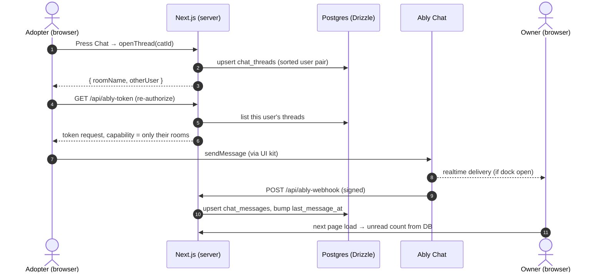
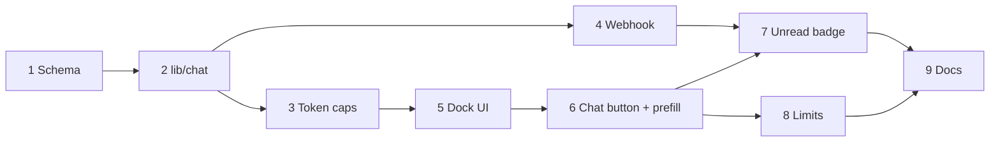

# Chat on Bilai

> [!abstract] Goal
> Adopters can message a cat's parent from inside Bilai.
>
> - A **Chat** button on every cat page, first in the row: `Chat · WhatsApp · Call`.
> - A **chat dock** at the bottom right of every page. It can be collapsed to a tab or opened, and opened wider. It's built with `@ably/chat-react-ui-kit`.
> - Messages travel over Ably Chat and are **mirrored into Postgres** through an Ably webhook.

Builds on [[ably_setup]], which already set up the token route, the server Ably client and `ChatProviders`.

## Decisions

> [!success] Decided (2026-11-19)
>
> | Topic                  | Decision                                                                                                                                                             |
> | ---------------------- | -------------------------------------------------------------------------------------------------------------------------------------------------------------------- |
> | Who sees Chat          | Signed-in users who **didn't list the cat**, on cats that **aren't adopted**. Shown even if the parent has no phone number or turned off WhatsApp/Call.              |
> | Signed-out on cat page | Keep the existing "Log in to contact the parent" link. No Chat button.                                                                                               |
> | Button order           | `Chat · WhatsApp · Call`                                                                                                                                             |
> | Conversation scope     | **One thread per pair of users** (adopter and owner), shared across all of that owner's cats.                                                                        |
> | Storage                | Ably delivers messages. **Every message is also saved in Postgres**, using an **Ably webhook** → `/api/ably-webhook`.                                                |
> | Owner's inbox          | The same dock, bottom right, on every page. It can be **hidden** (collapsed tab) and **extended** (wider, with the conversation list).                               |
> | Dock visibility        | The tab is on **every page**. Ably connects only the first time it's opened. Signed out, opening it shows "Sign in to check your messages" and a **Sign in** button. |
> | Listing expiry         | Chats **stay fully open** after a listing expires or is deleted. Threads are tied to people, not cats.                                                               |
> | Which cat it's about   | Pressing Chat **prefills the message box** with "Hi! I'm interested in {cat}: {link}".                                                                               |
> | Notifications          | **Unread badge on the dock tab** only.                                                                                                                               |
> | UI kit features        | **On:** edit and delete your own messages, typing indicators. **Off:** reactions, online presence.                                                                   |
> | Safety                 | **Message length and send-rate limits** only. No block or report in this round.                                                                                      |
> | Phones                 | Collapsed: a round button bottom right. Opened: a **full-screen sheet**.                                                                                             |

## Architecture



> [!important] What enforces what
>
> - **Who can read or post in a room:** the Ably token capability. It lists only rooms from `chat_threads` that the user belongs to. Everything in the UI is just display.
> - **Who can start a thread:** the `openThread(catId)` server action. A thread can only be started from a live cat listing you don't own. There is no "message any user id" endpoint.
> - **Postgres is a copy:** it's written by the webhook after Ably has accepted a message. It powers unread counts and keeps our own history. It doesn't block sends.

## Phase 1: Data model

`db/schema.ts`: three new tables.

```ts
// db/schema.ts (additions)
import { primaryKey, unique } from "drizzle-orm/pg-core";

// One row per pair of users. user_a < user_b keeps the pair unique
// whichever side starts the chat.
export const chatThreads = pgTable(
  "chat_threads",
  {
    id: uuid("id").primaryKey().defaultRandom(),
    roomName: text("room_name").notNull().unique(), // "dm:<userA>:<userB>"
    userA: text("user_a")
      .notNull()
      .references(() => user.id, { onDelete: "cascade" }),
    userB: text("user_b")
      .notNull()
      .references(() => user.id, { onDelete: "cascade" }),
    createdAt: timestamp("created_at", { withTimezone: true })
      .notNull()
      .defaultNow(),
    lastMessageAt: timestamp("last_message_at", { withTimezone: true }),
  },
  (t) => [
    unique("chat_threads_pair_key").on(t.userA, t.userB),
    check(
      "chat_threads_ordered_check",
      sql`${t.userA} collate "C" < ${t.userB} collate "C"`,
    ),
    index("chat_threads_user_b_idx").on(t.userB),
  ],
);

// Postgres copy of every Ably chat message, keyed by Ably's message serial.
export const chatMessages = pgTable(
  "chat_messages",
  {
    serial: text("serial").primaryKey(),
    threadId: uuid("thread_id")
      .notNull()
      .references(() => chatThreads.id, { onDelete: "cascade" }),
    senderId: text("sender_id")
      .notNull()
      .references(() => user.id, { onDelete: "cascade" }),
    text: text("text").notNull(),
    // Latest version applied. Ably version serials sort as strings, so an
    // older update or delete arriving late can be ignored.
    versionSerial: text("version_serial").notNull(),
    createdAt: timestamp("created_at", { withTimezone: true }).notNull(),
    editedAt: timestamp("edited_at", { withTimezone: true }),
    deletedAt: timestamp("deleted_at", { withTimezone: true }),
  },
  (t) => [
    index("chat_messages_thread_created_idx").on(t.threadId, t.createdAt),
  ],
);

// When each user last read each thread, for the unread badge.
export const chatReads = pgTable(
  "chat_reads",
  {
    threadId: uuid("thread_id")
      .notNull()
      .references(() => chatThreads.id, { onDelete: "cascade" }),
    userId: text("user_id")
      .notNull()
      .references(() => user.id, { onDelete: "cascade" }),
    lastReadAt: timestamp("last_read_at", { withTimezone: true }).notNull(),
  },
  (t) => [primaryKey({ columns: [t.threadId, t.userId] })],
);
```

- [x] Add the tables to `db/schema.ts`.
- [x] Write `drizzle/20261119000000_chat/migration.sql` by hand. `drizzle-kit generate` can't be used here: only the first migration has a snapshot, so it would re-emit every later migration. The SQL was generated against an empty scratch folder and only the chat statements were kept.
- [x] Applied 2026-11-19 by running the SQL file in one transaction. The database has no `drizzle.__drizzle_migrations` table (earlier migrations were also run by hand), so `drizzle-kit migrate` would try to re-run every migration.
- [x] No foreign key to `cats`. Threads have to outlive purged listings.
- [x] The ordering check uses `COLLATE "C"` (byte order) so it agrees with JavaScript's `<` in `pairFor`. The current database's collation is `C.UTF-8`, so it already agrees, but under a locale collation such as `en_US.UTF-8` mixed-case ids sort differently (`"a" < "B"`), which would reject valid pairs.

> [!note] Room names
> `dm:${userA}:${userB}` with the two ids sorted. better-auth ids are alphanumeric, so `:` is a safe separator. Check this once against real ids in the `user` table.

## Phase 2: Server data layer

New file `lib/chat.ts` (`import "server-only"`). Like `lib/cats.ts` and `lib/contact.ts`, it's the only place that reads the chat tables.

```ts
// lib/chat.ts
import "server-only";
import { and, eq, gt, isNull, ne, or, sql } from "drizzle-orm";
import { db } from "@/db";
import { chatMessages, chatReads, chatThreads, user } from "@/db/schema";

export const CHAT_MESSAGE_MAX_LENGTH = 2000;

export function pairFor(a: string, b: string) {
  const [userA, userB] = a < b ? [a, b] : [b, a];
  return { userA, userB, roomName: `dm:${userA}:${userB}` };
}

export async function getThreadRoomNames(userId: string) {
  const rows = await db
    .select({ roomName: chatThreads.roomName })
    .from(chatThreads)
    .where(or(eq(chatThreads.userA, userId), eq(chatThreads.userB, userId)));
  return rows.map((r) => r.roomName);
}

// Unread = messages from the other person, not deleted, newer than my last read.
export async function getUnreadCount(userId: string) {
  const [row] = await db
    .select({ n: sql<number>`count(*)::int` })
    .from(chatMessages)
    .innerJoin(chatThreads, eq(chatMessages.threadId, chatThreads.id))
    .leftJoin(
      chatReads,
      and(eq(chatReads.threadId, chatThreads.id), eq(chatReads.userId, userId)),
    )
    .where(
      and(
        or(eq(chatThreads.userA, userId), eq(chatThreads.userB, userId)),
        ne(chatMessages.senderId, userId),
        isNull(chatMessages.deletedAt),
        or(
          isNull(chatReads.lastReadAt),
          gt(chatMessages.createdAt, chatReads.lastReadAt),
        ),
      ),
    );
  return row?.n ?? 0;
}

// listThreads(userId): each thread with the other user's id, name and image,
// last_message_at and its own unread count, newest first. The dock calls it
// when it opens, not on every page load.
```

## Phase 3: Token capabilities

`app/api/ably-token/route.ts`: give each user access only to their own rooms, with only the features we want.

```ts
// app/api/ably-token/route.ts
import { getSession } from "@/lib/auth";
import { ablyServerClient } from "@/lib/ably";
import { getThreadRoomNames } from "@/lib/chat";

// Reactions (annotation-*) and presence are deliberately left out.
// Typing indicators use publish/subscribe.
const ROOM_OPS = [
  "publish",
  "subscribe",
  "history",
  "message-update-own",
  "message-delete-own",
];

export async function GET() {
  const session = await getSession();
  if (!session?.user) {
    return new Response("Not signed in", { status: 401 });
  }

  const rooms = await getThreadRoomNames(session.user.id);
  const capability: Record<string, string[]> = Object.fromEntries(
    rooms.map((room) => [room, ROOM_OPS]),
  );
  // Ably needs at least one entry. A private per-user channel also leaves
  // room for live unread updates later.
  capability[`inbox:${session.user.id}`] = ["subscribe"];

  const tokenRequest = await ablyServerClient.auth.createTokenRequest({
    clientId: session.user.id,
    capability: JSON.stringify(capability),
  });

  return Response.json(tokenRequest);
}
```

- [ ] After a **new** thread is created, the browser has to re-authorize so its token picks up the new room (see Phase 6).

> [!warning] Check against Ably
> Ably's Chat docs say capability keys are **room names** and list the operations above. They don't say whether a chat room's underlying channel is `<room>::$chat`. Once this is running, confirm that a token for room A can't attach to room B.

## Phase 4: Webhook mirror

New file `app/api/ably-webhook/route.ts`. This makes a fourth API route alongside auth, uploads and the token route, for the same reason as those: Ably has to POST to a real URL.

**Ably dashboard setup** (one rule per environment):

- Integration rule → Webhook, source **`channel.message`**, channel filter regex **`^dm:`**.
- URL `https://<host>/api/ably-webhook`, **batched + enveloped**, **Sign with key** set to the same key as `ABLY_API_KEY`.
- Local dev needs a tunnel (`cloudflared` or `ngrok`) and a separate dev rule that points at it.

```ts
// app/api/ably-webhook/route.ts
import { createHmac, timingSafeEqual } from "node:crypto";
import { after } from "next/server";
import { recordChatMessages } from "@/lib/chat";

const [KEY_ID, KEY_SECRET] = process.env.ABLY_API_KEY!.split(":");

function verify(
  body: string,
  keyHeader: string | null,
  sigHeader: string | null,
) {
  if (!sigHeader || keyHeader !== KEY_ID) return false;
  const expected = createHmac("sha256", KEY_SECRET)
    .update(body)
    .digest("base64");
  const a = Buffer.from(expected);
  const b = Buffer.from(sigHeader);
  return a.length === b.length && timingSafeEqual(a, b);
}

export async function POST(request: Request) {
  const body = await request.text(); // raw body: the signature covers these exact bytes
  if (
    !verify(
      body,
      request.headers.get("x-ably-key"),
      request.headers.get("x-ably-signature"),
    )
  ) {
    return new Response("Bad signature", { status: 401 });
  }

  const { items = [] } = JSON.parse(body) as {
    items?: {
      name: string;
      data: { channelId: string; messages: unknown[] };
    }[];
  };
  const batches = items.filter((i) => i.name === "channel.message");

  // Reply quickly so Ably doesn't retry. Writing to the DB is idempotent
  // anyway (upsert by serial).
  after(() => recordChatMessages(batches));
  return new Response(null, { status: 204 });
}
```

`recordChatMessages` in `lib/chat.ts`:

- [ ] Decode each batch's `messages` with the SDK's `Message.fromEncodedArray()`. Ably's docs say enveloped and batched payloads need it. Check whether `@ably/pubsub-server` exports `Message`.
- [ ] Turn the channel id into a room name. Strip a `::$chat` suffix if there is one, then look up `chat_threads` by `room_name`. If no thread matches, log it and skip.
- [ ] Map each message to `{ serial, action, versionSerial, clientId, text: JSON.parse(data).text, timestamp }`.
- [ ] **Sender check:** `clientId` must be `user_a` or `user_b` of that thread. Otherwise skip it and log.
- [ ] By action:
  - **create:** `insert … on conflict (serial) do nothing`, then set the thread's `last_message_at`.
  - **update:** set `text` and `edited_at`, only `where version_serial < incoming`.
  - **delete:** set `deleted_at`, under the same version check.
  - **summary** (reaction totals): ignore.
- [ ] Messages longer than `CHAT_MESSAGE_MAX_LENGTH` get stored cut to the limit and logged. See Phase 8.

> [!warning] Two things to check with a real message before relying on the mapping
>
> 1. **Action names.** Ably's docs disagree: the messages page says `message.create` / `message.update` / `message.delete`, while the integrations page says `message.created` / … with numeric values `0` / `1` / `2` (and `4` for summary). Log one raw webhook body for each action and map from what actually arrives.
> 2. **Where `text` lives.** The integrations page maps `data.text` → `text` once `data` is JSON-decoded. Confirm that in the logged body.

## Phase 5: Dock UI

### 5a. Mount it in the root layout

`app/layout.tsx`: a client context wraps the page so the Chat button can open the dock. The dock itself streams in under `Suspense`, because it reads the session. That keeps the static shell intact under `cacheComponents`.

```tsx
// app/layout.tsx (body)
<body className="flex min-h-screen flex-col font-sans antialiased">
  <ChatDockProvider>
    {children}
    <Suspense fallback={null}>
      <ChatDockSlot />
    </Suspense>
  </ChatDockProvider>
</body>
```

```tsx
// components/chat/ChatDockSlot.tsx (server component)
import { getSession } from "@/lib/auth";
import { getUnreadCount } from "@/lib/chat";
import ChatDock from "@/components/chat/ChatDock";

export default async function ChatDockSlot() {
  const session = await getSession();
  if (!session?.user) return <ChatDock signedIn={false} />;
  const unread = await getUnreadCount(session.user.id);
  return (
    <ChatDock
      signedIn
      me={{
        id: session.user.id,
        name: session.user.name,
        image: session.user.image ?? null,
      }}
      initialUnread={unread}
    />
  );
}
```

> [!note] This changes a decision in [[ably_setup]]
> That doc said not to mount chat in the root layout. This still respects the reason behind it: the layout mounts only a **tab and a context**. `ChatProviders` and the Ably SDK load via `next/dynamic` the **first time the dock is opened**, so ordinary page views open no Ably connection. Before implementing, read the `next/dynamic` and `cacheComponents` guides in `node_modules/next/dist/docs/` (working agreement 6).

### 5b. Dock state (context)

```tsx
// components/chat/ChatDockProvider.tsx
"use client";

type DockMode = "hidden" | "open" | "extended";
type OpenRequest = { roomName: string; other: ChatUser; prefill?: string };

type DockContext = {
  mode: DockMode;
  setMode: (mode: DockMode) => void;
  request: OpenRequest | null; // set by the Chat button, read by the panel
  openThread: (req: OpenRequest) => void;
  clearRequest: () => void;
};

export function ChatDockProvider({ children }: { children: React.ReactNode }) {
  const [mode, setMode] = useState<DockMode>("hidden");
  const [request, setRequest] = useState<OpenRequest | null>(null);
  const openThread = useCallback((req: OpenRequest) => {
    setRequest(req);
    setMode((m) => (m === "hidden" ? "open" : m));
  }, []);
  // …memoized value, <Ctx.Provider>
}

export const useChatDock = () => useContext(Ctx)!;
```

### 5c. The dock

```tsx
// components/chat/ChatDock.tsx
"use client";

const ChatPanel = dynamic(() => import("@/components/chat/ChatPanel"), {
  ssr: false,
  loading: () => (
    <p role="status" className="p-4">
      Connecting to chat…
    </p>
  ),
});

export default function ChatDock({ signedIn, me, initialUnread = 0 }: Props) {
  const { mode, setMode } = useChatDock();
  const [unread, setUnread] = useState(initialUnread);
  const [everOpened, setEverOpened] = useState(false);
  if (mode !== "hidden" && !everOpened) setEverOpened(true); // keep the connection once opened

  if (mode === "hidden") {
    return (
      <button
        type="button"
        onClick={() => setMode("open")}
        aria-label={unread ? `Messages, ${unread} unread` : "Messages"}
        className="fixed right-4 bottom-4 z-50 …" // pill on sm+, round icon button on phones
      >
        <MessagesSquare /> <span className="max-sm:sr-only">Messages</span>
        {unread > 0 && (
          <span className="rounded-full bg-action …">
            {unread > 99 ? "99+" : unread}
          </span>
        )}
      </button>
    );
  }

  return (
    <section
      role="dialog"
      aria-label="Messages"
      className={cn(
        "fixed z-50 flex flex-col overflow-hidden border border-border bg-card shadow-xl",
        "max-sm:inset-0", // phones: full-screen sheet
        "sm:right-4 sm:bottom-4 sm:rounded-xl",
        mode === "open" && "sm:h-[32rem] sm:w-[24rem]",
        mode === "extended" &&
          "sm:h-[min(40rem,calc(100dvh-2rem))] sm:w-[min(52rem,calc(100vw-2rem))]",
      )}
    >
      <DockHeader mode={mode} setMode={setMode} />{" "}
      {/* extend/shrink, hide (to tab), Esc hides */}
      {!signedIn ? (
        <div className="grid flex-1 place-items-center gap-3 p-6 text-center">
          <p>Sign in to check your messages</p>
          <Link href="/auth" className={buttonVariants({ size: "lg" })}>
            Sign in
          </Link>
        </div>
      ) : (
        everOpened && (
          <ChatPanel me={me!} mode={mode} onRead={() => setUnread(0)} />
        )
      )}
    </section>
  );
}
```

- [ ] **Hidden:** the tab, with the unread badge. **Open:** compact, one conversation, with a back button to the list. **Extended:** the list and the conversation side by side.
- [ ] Phones: opened is always a full-screen sheet. Extended means the same thing as open there.
- [ ] `Esc` hides the dock. Focus moves into the panel when it opens and goes back to the tab when it hides. The dock is non-modal, so the page behind stays usable on desktop.
- [ ] Hiding the dock keeps `ChatPanel` mounted (just not shown), so reopening it doesn't reconnect.

### 5d. Chat panel (UI kit)

```tsx
// components/chat/ChatPanel.tsx — loaded only via next/dynamic
"use client";

export default function ChatPanel({ me, mode, onRead }: PanelProps) {
  return (
    <ChatProviders>
      <ChatPanelInner me={me} mode={mode} onRead={onRead} />
    </ChatProviders>
  );
}

function ChatPanelInner({ me, mode, onRead }: PanelProps) {
  const { request, clearRequest } = useChatDock();
  const [threads, setThreads] = useState<ThreadSummary[] | null>(null);
  const [active, setActive] = useState<string | undefined>();
  const { setUserAvatar, setRoomAvatar } = useAvatar(); // exported by @ably/chat-react-ui-kit

  // Load threads once. Room names are id pairs, so give the kit readable names.
  useEffect(() => {
    void listMyThreads().then((rows) => {
      setThreads(rows);
      for (const t of rows) {
        setRoomAvatar(t.roomName, {
          displayName: t.other.name,
          src: t.other.image ?? undefined,
        });
        setUserAvatar(t.other.id, {
          displayName: t.other.name,
          src: t.other.image ?? undefined,
        });
      }
    });
    setUserAvatar(me.id, { displayName: me.name, src: me.image ?? undefined });
  }, [me]);

  // …render the thread list (mode === "extended", or no active thread) plus
  // <ChatRoomProvider name={active}><Conversation …/></ChatRoomProvider>
}
```

`ChatProviders`: turn the features we chose on or off.

```tsx
// components/providers/ChatProviders.tsx (change)
<ChatSettingsProvider
  initialGlobalSettings={{
    allowMessageUpdatesOwn: true,
    allowMessageDeletesOwn: true,
    allowMessageUpdatesAny: false,
    allowMessageDeletesAny: false,
    allowMessageReactions: false,
  }}
>
```

- [ ] Keep a reference to the pubsub client (e.g. expose it from `ChatProviders` through a small context), so Phase 6 can call `pubsubClient.auth.authorize()`.
- [ ] `<ChatWindow>` gets `enableTypingIndicators` on and `autoEnterPresence={false}` (presence is off).

## Phase 6: Chat button, opening a thread, prefill

### 6a. Server action

```ts
// app/(pages)/find_a_cat/[id]/chat-actions.ts
"use server";

import { db } from "@/db";
import { chatThreads } from "@/db/schema";
import { getSession } from "@/lib/auth";
import { getCatOwnerForChat, pairFor } from "@/lib/chat";

export async function openThread(
  catId: number,
): Promise<
  { ok: true; roomName: string; other: ChatUser } | { ok: false; error: string }
> {
  const session = await getSession();
  if (!session?.user) return { ok: false, error: "Please sign in to chat." };

  const owner = await getCatOwnerForChat(catId); // live, not adopted (lib/chat.ts or lib/cats.ts)
  if (!owner) return { ok: false, error: "This listing isn't available." };
  if (owner.id === session.user.id)
    return { ok: false, error: "This is your own listing." };

  const { userA, userB, roomName } = pairFor(session.user.id, owner.id);
  await db
    .insert(chatThreads)
    .values({ userA, userB, roomName })
    .onConflictDoNothing();

  return {
    ok: true,
    roomName,
    other: { id: owner.id, name: owner.name, image: owner.image },
  };
}
```

### 6b. Button

```tsx
// components/view/cat/ChatButton.tsx
"use client";

export default function ChatButton({
  catId,
  catName,
}: {
  catId: number;
  catName: string;
}) {
  const { openThread } = useChatDock();
  const [pending, startTransition] = useTransition();
  const [error, setError] = useState<string | null>(null);

  function start() {
    setError(null);
    startTransition(async () => {
      const result = await openThread_(catId); // the server action above
      if (!result.ok) return setError(result.error);
      openThread({
        roomName: result.roomName,
        other: result.other,
        prefill: `Hi! I'm interested in ${catName}: ${location.origin}/find_a_cat/${catId}`,
      });
    });
  }

  return (
    <Button
      type="button"
      size="lg"
      variant="outline"
      disabled={pending}
      onClick={start}
      className="h-11 px-4 font-bold"
    >
      <MessagesSquare /> {pending ? "Opening…" : "Chat"}
    </Button>
  );
}
```

When the panel sees a `request` for a room it doesn't have yet: `await pubsubClient.auth.authorize()` (new token with the new room), add the thread to the list, select it, put the prefill in the composer, then `clearRequest()`.

### 6c. Prefilling the message

The kit's `MessageInput` has **no initial-value prop**. `customFooterContent` adds content next to the input and doesn't replace it. So the conversation pane is put together from the kit's pieces with our own composer:

```tsx
// components/chat/Conversation.tsx (inside <ChatRoomProvider name={roomName}>)
<ChatWindowHeader>{/* other user's avatar + name */}</ChatWindowHeader>
<ChatMessageList
  messages={activeMessages} // from the kit's useMessageWindow()
  isLoading={loading}
  hasMoreHistory={hasMoreHistory}
  onLoadMoreHistory={loadMoreHistory}
  onEdit={(m, text) => updateMessage(m.serial, { text })}
  onDelete={(m) => deleteMessage(m.serial)}
  enableTypingIndicators
/>
<ChatWindowFooter>
  <Composer initialText={prefill} />
</ChatWindowFooter>
```

```tsx
// components/chat/Composer.tsx
"use client";
import { useMessages, useTyping } from "@ably/chat/react";

export function Composer({ initialText = "" }: { initialText?: string }) {
  const [text, setText] = useState(initialText);
  const { sendMessage } = useMessages();
  const { keystroke, stop } = useTyping();
  const lastSent = useRef(0);

  async function send() {
    const value = text.trim();
    if (!value || value.length > CHAT_MESSAGE_MAX_LENGTH) return;
    if (Date.now() - lastSent.current < SEND_COOLDOWN_MS) return; // Phase 8
    lastSent.current = Date.now();
    setText("");
    await stop();
    await sendMessage({ text: value });
  }
  // <textarea maxLength={CHAT_MESSAGE_MAX_LENGTH} value={text}
  //   onChange={(e) => { setText(e.target.value); void keystroke(); }}
  //   onKeyDown={Enter sends, Shift+Enter adds a newline} /> + Send button + "1,840 / 2,000" counter near the limit
}
```

> [!tip] If putting the pieces together gets messy
> Use the kit's own `<ChatWindow roomName=… enableTypingIndicators />` instead, and put a **"Send: Hi! I'm interested in Mittens"** chip in `customFooterContent` that sends with one tap. That wouldn't give a true prefill, so get it agreed before switching.

### 6d. The contact row

`components/view/cat/ContactButtons.tsx` and `app/(pages)/find_a_cat/[id]/page.tsx`:

```tsx
// page.tsx
const isOwner = session?.user.id === cat.owner.id;
// …
<ContactButtons
  catId={cat.id}
  catName={cat.name}
  canChat={Boolean(session?.user) && !isOwner}
  whatsapp={cat.contactWhatsapp}
  call={cat.contactCall}
  hasPhone={cat.owner.hasPhone}
  isLoggedIn={Boolean(session?.user)}
  isOwner={isOwner}
/>;
```

```tsx
// ContactButtons.tsx: Chat first, and early returns no longer hide it
const showPhoneButtons = hasPhone && (whatsapp || call);

return (
  <div className="flex flex-col gap-2">
    <div className="flex flex-wrap gap-3">
      {canChat && <ChatButton catId={catId} catName={catName} />}
      {showPhoneButtons && whatsapp && <WhatsAppButton … />}
      {showPhoneButtons && call && <CallButton … />}
    </div>
    {!hasPhone && <p className="text-sm text-muted-foreground">The parent hasn't added a phone number yet.</p>}
    {error && <p role="alert" className="text-sm text-destructive">{error}</p>}
  </div>
);
```

- [ ] The owner branch and the signed-out branch stay as they are. Adopted cats still skip the whole block in `page.tsx`.
- [ ] Note: `cats_contact_method_check` in the schema requires WhatsApp or Call to be on, so the "no contact method" case can't happen. Only the no-phone case needs handling.

## Phase 7: Unread badge

- [ ] The tab's count comes from `getUnreadCount()` in `ChatDockSlot`. It refreshes on every navigation, because the slot is dynamic and inside `Suspense`.
- [ ] `markThreadRead(roomName)` server action: checks membership, then upserts `chat_reads.last_read_at = now()`. Call it when a thread is opened, and when a message arrives while that thread is on screen. Lower the badge on the client right away.
- [ ] Out of scope: a badge that updates live **while the dock is closed**. That needs an Ably connection on every page. The `inbox:{userId}` capability from Phase 3 leaves room for it later (the webhook would publish a small "new message" event there).

## Phase 8: Length and rate limits

| Limit                 | Where                                                                                                                                                 |
| --------------------- | ----------------------------------------------------------------------------------------------------------------------------------------------------- |
| 2,000 characters      | `Composer` (`maxLength` + check before send). The webhook cuts anything longer before storing and logs it.                                            |
| One send per ~1 s     | `SEND_COOLDOWN_MS` in `Composer`. Ably also applies its own per-connection rate limits.                                                               |
| Threads per user/hour | `openThread` refuses a burst of **new** threads (e.g. more than 20 an hour, counted from `chat_threads.created_at`). Stops spam across many listings. |

> [!warning] Client limits can be bypassed
> Someone with a valid token can call Ably directly and skip `Composer`. Ably's docs don't list a built-in message length rule. Hard enforcement on the server would need Ably's **custom moderation** (a before-publish check). That's a follow-up to evaluate, not part of v1.

## Phase 9: Housekeeping

- [ ] `.env`: nothing new. The webhook verifies with `ABLY_API_KEY`. Write the Ably dashboard rule steps into [[ably_setup]].
- [ ] `AGENTS.md` "Project file structure" (working agreement 2):
  - `app/api/ably-webhook/route.ts`
  - `app/(pages)/find_a_cat/[id]/chat-actions.ts`
  - `components/chat/` (ChatDockProvider, ChatDockSlot, ChatDock, ChatPanel, Conversation, Composer)
  - `components/view/cat/ChatButton.tsx`
  - `lib/chat.ts`
  - `docs/` (not listed yet)
- [ ] `AGENTS.md` Architecture: a short **Chat** paragraph (thread per pair, capabilities from `chat_threads`, webhook mirror, dock loads Ably lazily). Change "server actions, not API routes" to list the webhook as another exception.
- [ ] `npm run format:check` at the end.

## Order of work



Phase 5 can begin with a fake thread list while phases 3 and 4 are being built.

## Verification

- [ ] `npx tsc --noEmit`, `npm run lint`, `npm run format:check`, `npm run test`
- [ ] **Tests** (`tests/*.test.mjs`, vm-isolated like `tests/delete-listing.test.mjs`):
  - [ ] `openThread`: refuses signed-out users, your own listing, and missing or adopted cats. Calling it twice with the same pair creates one row.
  - [ ] Webhook: a bad signature gets 401. Create then update then delete applies in order, and a late, older update is ignored. A sender who isn't in the thread is skipped.
  - [ ] `pairFor`: the room name is the same whichever user starts.
- [ ] **By hand, two browsers** (adopter and owner), webhook reaching the dev server through a tunnel:
  - [ ] Cat page buttons read `Chat · WhatsApp · Call`. The owner sees no Chat. A signed-out visitor sees only the log-in link. An adopted cat shows no Chat.
  - [ ] Parent with no phone: Chat still shows.
  - [ ] Pressing Chat opens the dock on that thread with the prefilled text, which can be edited.
  - [ ] A message shows up live in the owner's dock, and a row lands in `chat_messages`. Edits and deletes are mirrored. Typing indicator works. No reaction button and no presence dot.
  - [ ] Owner's tab shows an unread badge after navigating. Opening the thread clears it.
  - [ ] An adopter who chats about two cats from the same owner gets **one** thread.
  - [ ] The thread still works after the listing expires or is deleted.
  - [ ] Signed out, the dock tab shows "Sign in to check your messages" and a Sign in button.
  - [ ] A token for one thread can't attach to another user's room (try it in the console).
  - [ ] Network tab: an ordinary page view with the dock never opened makes **no** Ably request.
  - [ ] Phone width (375px): round button, full-screen sheet, no horizontal scroll, input stays visible with the keyboard open.
