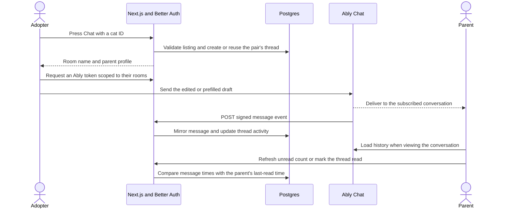

# Bilai chat code walkthrough

**Ably delivers messages and supplies the history in the chat window.** Bilai uses Better Auth and Postgres to decide who belongs to each conversation. Ably also sends a signed webhook so Bilai can keep a Postgres copy of the messages and calculate unread counts. An adopter and a cat's parent share one conversation across all of that parent's listings.

This walkthrough follows the code merged into `main` at `4800d9e`. Snippets show the relevant parts of that snapshot. The [original implementation report](chat_implementation_report.md) records the build and its live checks. The [Ably setup notes](ably_setup.md#webhook-mirroring-chat-into-postgres) cover the webhook rule required in each environment.



## How the feature landed

| Commit    | What it introduced                                                                                                                                                                                                          |
| --------- | --------------------------------------------------------------------------------------------------------------------------------------------------------------------------------------------------------------------------- |
| `5d08167` | Ably scaffolding. Added the UI kit and server SDK to `package.json` and pinned the resolved dependencies in `package-lock.json`. Added a provider, server Ably client and a token route that initially set only `clientId`. |
| `f96ab4f` | Phase 1. Added the three chat tables to the Drizzle schema, their first SQL migration and the implementation plan.                                                                                                          |
| `1995806` | Phase 2. Added chat queries, room-name helpers and their tests, shared limits, and the migration for `started_by`.                                                                                                          |
| `c0979ac` | Phase 3. Scoped tokens to the user's rooms and added the private inbox capability and `Cache-Control: no-store`.                                                                                                            |
| `80417d8` | Phase 4. Added the signed webhook and version-aware Postgres mirror.                                                                                                                                                        |
| `14a38a0` | Phase 5. Mounted the dock site-wide and added lazy provider loading, the conversation list, message history, composer and layered kit CSS.                                                                                  |
| `874cbc4` | Phase 6. Connected the listing's Chat button to thread creation and the prefilled composer.                                                                                                                                 |
| `75d7086` | Phase 7. Added unread badges, read marks and refresh triggers.                                                                                                                                                              |
| `3a450e8` | Phase 8. Added isolated Node tests for thread creation and the webhook route.                                                                                                                                               |
| `b9d6990` | Phase 9. Updated the architecture notes and plan and added the original implementation report.                                                                                                                              |
| `4800d9e` | Merged `feat/chat` into `main`. Both branches are present in their respective `origin` tracking refs in this checkout.                                                                                                      |

The range also contains `7192fcd` (three-month listing expiry, which the chat lookup inherits), `9e7c21a` (shared footer), and `d0f341b` (listing removal UI and tests). Use these Git commands to inspect the commits, filter a diff to one file, or read that file at the merge:

```sh
git log --reverse --oneline 5d08167^..4800d9e
git show 874cbc4 -- 'app/(pages)/find_a_cat/[id]/chat-actions.ts'
git show 4800d9e:lib/chat.ts
```

## 1. What Postgres stores

The [Drizzle schema](../db/schema.ts) supplies typed table definitions to the existing [Neon HTTP client](../db/index.ts). The [first chat migration](../drizzle/20261119000000_chat/migration.sql) creates the tables and indexes. The [second migration](../drizzle/20261119010000_chat_thread_started_by/migration.sql) adds the nullable `started_by` foreign key and an index over `(started_by, created_at)`. The hand-written SQL uses existence guards and Drizzle statement breakpoints. The second migration also checks `pg_constraint` before adding its foreign key.

| Table           | Fields and rules                                                                                                                                                                                                                                                                                                                                                                                                                                                                                                                                                               |
| --------------- | ------------------------------------------------------------------------------------------------------------------------------------------------------------------------------------------------------------------------------------------------------------------------------------------------------------------------------------------------------------------------------------------------------------------------------------------------------------------------------------------------------------------------------------------------------------------------------ |
| `chat_threads`  | `id` is a generated UUID. `room_name` is unique, as is `(user_a, user_b)`. Both participant IDs reference `user` and cascade on account deletion. The order check enforces `user_a < user_b`. The pair index supports lookups by `user_a`, and an extra index covers `user_b`. `started_by` identifies the initiator for rate limiting and uses `ON DELETE SET NULL`. `created_at` defaults to DB time. `last_message_at` starts empty and tracks the newest mirrored create event. Without a listing foreign key, the pair's conversation survives listing expiry or removal. |
| `chat_messages` | `serial` is the Ably message identity and primary key. `version_serial` tracks the last applied revision. `thread_id` and `sender_id` are cascading foreign keys. `text` holds the mirrored body. `created_at` is the original send time, and `edited_at` and `deleted_at` are nullable timestamps set when the mirror handles those events. `(thread_id, created_at)` is indexed for per-thread reads.                                                                                                                                                                        |
| `chat_reads`    | `(thread_id, user_id)` is the primary key, allowing one `last_read_at` timestamp per user in each thread. Both IDs are cascading foreign keys. The server action checks membership before creating or updating this row.                                                                                                                                                                                                                                                                                                                                                       |

The room name is built in [lib/chat-rooms.ts](../lib/chat-rooms.ts). This helper is pure TypeScript and safe to import without pulling in the DB or auth code.

```ts
const [userA, userB] = a < b ? [a, b] : [b, a];
return { userA, userB, roomName: `${DM_ROOM_PREFIX}${userA}:${userB}` };
```

- `pairFor(a, b)` throws for identical IDs or IDs outside `[A-Za-z0-9_-]+`. Both input orders therefore produce the same `dm:<userA>:<userB>` string. ASCII IDs make JavaScript's ordering agree with the database check `user_a COLLATE "C" < user_b COLLATE "C"` even if the database's default collation differs.
- `parseDmRoomName` checks the prefix, exactly two valid IDs and strict order, returning the pair or `null`. The current callers are its tests.
- `roomNameFromChannel` strips a trailing `::$chat` for webhook lookup and passes bare room names through.

## 2. From the listing to the thread

[The cat detail page](<../app/(pages)/find_a_cat/[id]/page.tsx>) loads the listing and session together. It computes `isOwner`, hides the contact section for an adopted cat, and passes `canChat={Boolean(session?.user) && !isOwner}` and the cat's name into [ContactButtons](../components/view/cat/ContactButtons.tsx). The same `isOwner` still gates the listing deletion control.

`ContactButtons` puts Chat first. For a signed-in non-owner, Chat depends on `canChat` and each phone button separately depends on `hasPhone` and its enabled flag. A parent without a number gets a note. Owners see a description of how adopters can reach them, using `Intl.ListFormat` when a phone is present. Signed-out visitors get a login link when the parent has a phone, or the missing-number note otherwise. WhatsApp and Call still get their URLs on demand via `getContactUrl`. WhatsApp pre-opens a tab during the click, clears its opener, then navigates or closes it once the action returns. Phone actions maintain their own pending and error state.

[ChatButton](../components/view/cat/ChatButton.tsx) uses `useTransition` to disable the button and display “Opening…” while `openThread(catId)` runs. Expected failures come back as text beneath the button, and exceptions produce a generic alert. The success path hands the room and draft to the dock context. Opening Chat leaves the draft for the adopter to review and send.

```ts
dock.openThread({
  roomName: result.roomName,
  other: result.other,
  prefill: `Hi! I'm interested in ${catName}: ${window.location.origin}/find_a_cat/${catId}`,
});
```

In [chat-actions.ts](<../app/(pages)/find_a_cat/[id]/chat-actions.ts>), `openThread` reads the session itself via [getSession](../lib/auth.ts), which passes the current request headers to Better Auth. `getCatOwnerForChat(Number(catId))` checks for a positive safe integer, joins the listing to its owner, and filters out adopted and expired cats. `isLiveListing` uses [database time and the three-month lifetime](../lib/listing-expiry.ts). The action rejects signed-out users, unavailable listings and self-chat before inserting anything.

```ts
const created = await db
  .insert(chatThreads)
  .values({ userA, userB, roomName, startedBy: session.user.id })
  .onConflictDoNothing()
  .returning({ id: chatThreads.id });
```

- A unique conflict returns no inserted row and the action reuses the deterministic room name. An existing conversation stays available through the dock after a cat is adopted or expires. Opening it from a listing still requires an eligible listing.
- After a successful insert, the action counts this user's `started_by` rows created within the past hour, including the new row. Above 20, it deletes that new row and returns an error. Insert, count and delete are separate operations, so concurrent calls can affect each other's counts.
- Success returns `{ ok: true, roomName, other: owner }`. The owner object contains only `id`, `name` and `image`. The listing ID and name appear in the draft, while the thread row holds the participant pair.

## 3. Who can join an Ably room

[lib/ably.ts](../lib/ably.ts) creates one server-only HTTP client using `ABLY_API_KEY`. The browser's SDK calls [GET /api/ably-token](../app/api/ably-token/route.ts). The route reads the session, returns `401` without a user, and gets the signed-in user's room names through `getThreadRoomNames`. Bilai returns the signed token request with `Cache-Control: no-store`. The SDK uses that request to obtain an Ably token.

```ts
const capability: Record<string, string[]> = Object.fromEntries(
  rooms.map((room) => [room, ROOM_OPS]),
);
capability[`inbox:${session.user.id}`] = ["subscribe"];

const tokenRequest = await ablyServerClient.auth.createTokenRequest({
  clientId: session.user.id,
  capability: JSON.stringify(capability),
});
```

Each room gets `publish`, `subscribe`, `history`, `message-update-own` and `message-delete-own`. These grant the message and typing workflow and restrict edits and deletes to one's own messages. The capability omits presence and reactions. Keys are room names such as `dm:a:b`, while the webhook sees the backing channel `dm:a:b::$chat`. The private `inbox:<userId>` entry keeps the capability populated when the user has zero threads. The current dock has no inbox-channel subscriber or publisher.

## 4. How the dock starts and changes rooms

### The shell and its state

[RootLayout](../app/layout.tsx) wraps the page and a `Suspense`-wrapped `ChatDockSlot` in [ChatDockProvider](../components/chat/ChatDockProvider.tsx). [ChatDockSlot](../components/chat/ChatDockSlot.tsx) reads the session on the server. It sends `signedIn: false` for guests, or a minimal profile and initial unread count for signed-in users. The `null` Suspense fallback lets the page shell render while that session-dependent work loads.

- **`ChatDockProvider`** owns two pieces of UI state, `mode` (`hidden`, `open` or `extended`) and a pending `OpenRequest` (`roomName`, `other`, optional `prefill`). Its `openThread` context callback queues the request and changes `hidden` to `open`, preserving the user's chosen size otherwise. `clearRequest` removes the request after consumption. `useCallback` stabilizes the callbacks, `useMemo` builds the context value, and `useChatDock` throws when used outside the provider. This context's `openThread` is a client callback. The action with the same name in §2 handles DB creation.
- **[ChatDock](../components/chat/ChatDock.tsx)** renders the fixed Messages button and the labelled, nonmodal dialog. Its section is full-screen on phones and compact or extended on desktop. The signed-out pane links to `/auth` and closes the dock on click. The resize controls are limited to signed-in desktop users. Opening focuses the section, and hiding returns focus to the tab. Escape closes the dock unless already handled, an editor field has focus, or a modal such as the delete confirmation is open.

```tsx
const ChatPanel = dynamic(() => import("@/components/chat/ChatPanel"), {
  ssr: false,
  // The source also supplies a status fallback while the bundle loads.
});
```

`panelLoaded` latches on first open. For a signed-in user this mounts the lazy `ChatPanel`. The `hidden` attribute hides the dock while the panel and its Ably connection stay mounted. A visitor who never opens the dock skips this bundle and connection.

### Realtime providers and styling

The outer `ChatPanel` component wraps its inner `Panel` in [ChatProviders](../components/providers/ChatProviders.tsx). It uses the pre-existing `@ably/pubsub-device` for Realtime and `@ably/chat` for rooms and hooks. The scaffolding commit added `@ably/chat-react-ui-kit` for chat UI and `@ably/pubsub-server` for signing and webhook decoding. The provider creates both browser clients in a mount effect and shows a status until they exist.

```ts
const realtime = createClient({ authUrl: "/api/ably-token" });
const chat = createChatClient(realtime);
setClients({ realtime, chat });

return () => {
  void chat.dispose().finally(() => realtime.close());
};
```

The session-backed token supplies `clientId`. `ChatClientProvider` exposes the chat client to room hooks, and `useChatRealtime` reads the underlying Realtime client so `Panel` can call `auth.authorize()` when its room list changes. The kit's `AvatarProvider` handles display data. `ChatSettingsProvider` enables editing and deleting one's own messages and disables doing either to others' messages, as well as reactions. Those flags control the UI. The token determines actual permissions. The kit can set `dark` on `<html>`, so its `ThemeProvider` is pinned to light with system detection and persistence disabled.

The dock uses `bilai-theme` because it sits outside `BilaiPage`. The provider imports [ably-chat-kit.css](../components/chat/ably-chat-kit.css) with the lazy panel. Its stylesheet layer sits above `base` and below `components` and `utilities`, as ordered in [globals.css](../app/globals.css). This lets Bilai's utilities win over the kit's normal Tailwind v3 reset rules.

```css
/* app/globals.css */
@layer theme, base, ably-chat, components, utilities;

/* components/chat/ably-chat-kit.css */
@import "@ably/chat-react-ui-kit/dist/style.css" layer(ably-chat);
```

### The list and the selected room

In [ChatPanel.tsx](../components/chat/ChatPanel.tsx), `threads` is `null` until loaded. `active` tracks the selected room, `prefill` holds text paired with a room, and `error` selects an alert view. `knownRooms` is a ref for comparing fetched room membership without rendering it.

- `refresh()` calls `listMyThreads()`, replaces the set of known rooms and asks Realtime to reauthorize when it detects a newly added room after the first load. It registers the current user's avatar and each counterpart's avatar by user ID and by room name for the kit. It then stores and returns the fetched thread list.
- The `wasHidden` effect refreshes on initial opening and reopening. A separate effect handles a request from a cat page. Once Realtime exists, it explicitly reauthorizes if an existing known-room list lacks the requested room, refreshes with `authorizeNew: false`, then selects the room, sets its prefill, and clears the context request. On first load the code normally relies on initial token issuance. Effect cleanup prevents an obsolete request from selecting a room after the async work returns. Load or selection failures are logged and displayed.
- `ThreadList` uses `nav` and a button per room with `aria-current` on the active one. Each row shows the other user's name, avatar, and unread count capped visually at `99+`. The empty view directs users to a cat page. [ChatAvatar](../components/chat/ChatAvatar.tsx) shows a decorative, cropped profile image without sending a referrer. Without an image, it takes the first character of the first and last name words, uppercases them and falls back to `?` for an empty name.
- In compact or phone mode, the list gives way to the conversation. Extended desktop shows the list beside it, with a “Pick a conversation” prompt when there is no selection. `ChatRoomProvider` is keyed by room name, so switching rooms remounts the message and composer state. The prefill passes through only for its matching room. Back clears the active room, and `visible` tells the conversation whether the panel is showing.

## 5. History, sending, edits and typing

[Conversation](../components/chat/Conversation.tsx) composes the kit's `ChatWindowHeader`, `ChatMessageList` and `ChatWindowFooter`. The header uses the contact name, avatar and Back control. The list receives message history, loading and pagination state, edit/delete handlers, and the typing indicator flag. The footer mounts Bilai's prefillable composer. Building from these pieces gives the window a human name while room IDs stay internal. The Back button is hidden in extended desktop mode since the list is already visible there.

[useConversationMessages](../components/chat/useConversationMessages.ts) fills the role of the kit's internal, unexported history hook. Its `useMessages` subscription yields send, update, delete and `historyBeforeSubscribe` methods for the selected room.

```ts
const bySerial = new Map(current.map((m) => [m.serial, m]));
for (const message of incoming) {
  const existing = bySerial.get(message.serial);
  bySerial.set(message.serial, existing ? existing.with(message) : message);
}
```

- `merge` deduplicates by the original message serial, keeps the newer revision with `Message.with()` and returns the messages in ascending serial order. Both history and returned mutation results feed this path. The live listener merges creates and applies edits/deletes with `m.with(event)` to a matching loaded message.
- The history effect waits for `historyBeforeSubscribe`, then requests up to 50 messages by default. It merges that page into the live state, stores the page in a ref and updates the loading and `hasMore` flags. Cleanup ignores a result after the effect is replaced. When Ably supplies a new history function after a subscription discontinuity, the effect requests the latest page again. A first-page error logs and clears loading.
- `loadMore()` checks `hasNext()`, gets the next page, merges it and updates the ref and flag. The kit calls it when more history is requested. The hook accumulates messages in memory for the selected room. All displayed history comes from Ably via this hook.
- For edits, `Conversation` calls `updateMessage` with the serial and new text while preserving `metadata` and `headers`. For deletes, it calls `deleteMessage` with the serial and a description. The kit supplies the edit and confirmation UI. Both handlers merge the returned message, with failures logged to the console.

[Composer](../components/chat/Composer.tsx) keeps its text, send-pending flag and error in state. A ref holds the last send attempt time, and another references the textarea. It initializes state from `initialText`, then focuses and moves the cursor to the end for a prefill. The text state persists while the same composer stays mounted. If a user opens another listing for the same person while that room is already mounted, the new `initialText` can refocus the field without replacing the existing draft.

```ts
const message = await sendMessage({ text: value });
setText("");
onSent(message);
stop().catch(() => {});
```

- The form submit and Enter key both call `send()`. Shift+Enter allows a newline. The controlled textarea has `maxLength={2000}`, a screen-reader label and the contact's name as the placeholder. It grows using `field-sizing: content` up to its height cap where supported. The character count appears in the last 200 characters. An error takes its place as an alert.
- `send()` trims the text, exits for empty text or an in-flight send, checks the length and enforces a one-second delay between attempts in this composer. It records the attempt time before awaiting `sendMessage({ text: value })`. On success it clears the draft, merges the returned message and stops the typing indicator. On failure it keeps the draft and shows an error. Either outcome clears pending state and refocuses the field.
- `useTyping()` provides `keystroke()` on changes containing non-whitespace and `stop()` when the input empties or a send succeeds. The composer ignores typing-call failures so they leave sending usable. The remote room's kit list renders typing indicators.
- [lib/chat-limits.ts](../lib/chat-limits.ts) defines `CHAT_MESSAGE_MAX_LENGTH = 2000`, `CHAT_SEND_COOLDOWN_MS = 1000`, and `MAX_NEW_THREADS_PER_HOUR = 20`. The first is shared by the composer and mirror. The cooldown is local to the composer, and the hourly quota is checked server-side for newly created threads. The shown edit handler sends edits through Ably, while the webhook caps the Postgres copy. The code does not configure an Ably-side length rule.

## 6. How Ably events become Postgres rows

[POST /api/ably-webhook](../app/api/ably-webhook/route.ts) is an external callback. It splits `ABLY_API_KEY` into a key name and secret at module load and authenticates requests against the original body text before parsing JSON.

```ts
const expected = Buffer.from(
  createHmac("sha256", KEY_SECRET).update(body).digest("base64"),
);
const given = Buffer.from(signature);
return expected.length === given.length && timingSafeEqual(expected, given);
```

`isSignedByAbly` also checks that a secret and signature exist and that `x-ably-key` matches. `POST` returns `401` for a bad signature and `400` for invalid JSON after a valid signature. `batchesOf` accepts a batched `items` array, selecting `channel.message` entries with `data.channelId` and a `messages` array, or a single `{ channel, messages }` envelope. An unrecognized envelope yields no work. The route decodes each accepted array with `Message.fromEncodedArray()` and awaits `recordChatMessages`. Success returns an empty `204`. Decode or DB errors propagate so the request can fail and Ably can retry.

`recordChatMessages` in [lib/chat.ts](../lib/chat.ts) does the mirroring:

1. **Find the thread.** Strip `::$chat` and look up the room name in `chat_threads`. An unknown room is logged and skipped. Each message must have a recognized action, a serial and a client ID. The client ID must match either thread user. A sender outside the pair is logged and dropped.
2. **Normalize the payload.** `DecodedChatMessage` describes the fields needed from the SDK. `actionOf` accepts create, update and delete as `message.create`/`message.created` and their equivalents, or numeric values `0`/`1`/`2`. Other actions, including summaries, are skipped. `textOf` reads string `data.text` after using `safeJson` if `data` itself is a string. Invalid JSON or missing/non-string text becomes empty. The mirror clips text to 2,000 characters and logs the truncation.
3. **Build the row.** The version comes from `version.serial` or a string `version`, falling back to the message serial. `createdAt` uses Ably's message timestamp or the current time if absent. Deletes store empty text. Update and delete timestamps come from Bilai's processing time.
4. **Apply events in version order.** Create uses `onConflictDoNothing()`. Updates and deletes can insert a row if they arrive before the create. On conflict, an update changes text, `editedAt` and the version. A delete blanks text and sets `deletedAt` and the version. The statement below prevents older or identical versions from replacing newer ones. A late create leaves the earlier edit/delete row intact.
5. **Record activity.** Track the highest `createdAt` among valid create events in the batch. A final update uses `greatest(coalesce(last_message_at, newest), newest)` so a delayed create cannot move the thread back in time. Edits and deletes leave activity ordering alone.

```ts
setWhere: sql`${chatMessages.versionSerial} collate "C" < ${versionSerial} collate "C"`,
```

The route awaits its writes before acknowledging delivery. A retry after a partial batch reuses the same serials and version checks. If delivery is missing or delayed, Ably can still show the message while unread counts and the Postgres mirror lag. The checkout cannot establish whether an environment currently has a working webhook rule.

## 7. How the thread list and unread badges are calculated

The rest of [lib/chat.ts](../lib/chat.ts) is the server-side query layer. Its `server-only` import guards runtime use from client bundles. Client components import `ChatUser` and `ThreadSummary` as types. A `ThreadSummary` carries `roomName`, the other participant's `ChatUser`, a nullable ISO `lastMessageAt` and a numeric `unread` count.

| Helper                                       | Query or write                                                                                                                                                                                                                                                                                                        |
| -------------------------------------------- | --------------------------------------------------------------------------------------------------------------------------------------------------------------------------------------------------------------------------------------------------------------------------------------------------------------------- |
| `isMember` / `getThreadRoomNames`            | Match either participant column to the current user. Select only the room names for the token route.                                                                                                                                                                                                                  |
| `readsJoin` / `unreadFor` / `getUnreadCount` | Join messages to their thread, left-join the user's read row and count unread messages across threads the user belongs to. A missing count falls back to `0`.                                                                                                                                                         |
| `listThreads`                                | Identify the other user with SQL `CASE` and join their profile. Each row gets an unread count from a correlated subquery using the same predicates as the total. Sort descending by `coalesce(last_message_at, created_at)` so an empty thread uses its creation time. Map the selected columns to a `ThreadSummary`. |
| `getThreadForMember`                         | Require both the room name and membership. Return the thread ID and participant IDs, or `null`.                                                                                                                                                                                                                       |
| `getCatOwnerForChat`                         | Validate the numeric ID and return the minimal owner profile for a live, non-adopted listing as described in §2.                                                                                                                                                                                                      |
| `countThreadsStartedSince`                   | Count rows where `started_by` equals the user and `created_at` is at or after the supplied cutoff.                                                                                                                                                                                                                    |
| `markThreadRead`                             | Upsert the current server time as `lastReadAt` for the `(threadId, userId)` primary key. Its caller checks membership.                                                                                                                                                                                                |

```ts
const unreadFor = (userId: string) =>
  and(
    ne(chatMessages.senderId, userId),
    isNull(chatMessages.deletedAt),
    or(
      isNull(chatReads.lastReadAt),
      gt(chatMessages.createdAt, chatReads.lastReadAt),
    ),
  );
```

A message counts if the other person sent it, it has no deletion timestamp, and either the user has never read the thread or the original send time is strictly newer than the read mark. If the parent last read at 10:00 and the adopter sends at 10:05, the message adds one unread after the webhook stores it. Editing it leaves the count at one. Reading the conversation or deleting the message takes the count back to zero on the next query.

[components/chat/actions.ts](../components/chat/actions.ts) exposes `listMyThreads`, `getMyUnreadCount` and `markRead`. Each reads its own session. Signed-out calls get `[]`, `0` or an early return respectively. `markRead` also checks that the room name is a string and looks up the room for that session user before writing.

```ts
const latest = messages.at(-1)?.serial;
useEffect(() => {
  if (visible) onRead(thread.roomName);
}, [visible, latest, thread.roomName, onRead]);
```

- Inside `Conversation`, the effect runs when the visible room opens and when the newest message serial changes. It uses dock visibility as a proxy for reading and writes a time for the whole room. It has no per-message read receipt or browser tab focus check.
- `Panel.onRead` sends the action and immediately zeros that room's count in local state. A failed write is ignored by the UI. An effect sums all the thread counts and reports the total to `ChatDock` through `onUnreadChange`.
- `ChatDockSlot` supplies the first count. The dock skips its initial refresh and later calls `getMyUnreadCount` when the pathname changes with the dock hidden or when the user hides it. Its effect ignores stale responses on cleanup. The visual badge caps at `99+`; the button's accessible label contains the full count.
- The count refresh and the live connection are separate. The list refreshes on reopening or when a listing button requests a room. A brand-new incoming thread can remain absent while the dock stays open, and a count fetched before the webhook write can lag until the next refresh.

## 8. What the tests exercise

- [lib/chat-rooms.test.ts](../lib/chat-rooms.test.ts) has 13 Vitest cases. They cover symmetric pair creation, ASCII ordering, bad IDs and self-chat, the parser's valid round trip and invalid shapes, and channel suffix handling.
- [tests/chat.test.mjs](../tests/chat.test.mjs) uses `ts.transpileModule` to load selected TypeScript modules as CommonJS, then `vm.runInNewContext` to inject mocks and globals. It uses the real schema and room helpers, fake DB insert/delete chains for `openThread`, and a fake Ably decoder and mirror function for the webhook. `signedRequest` signs a fixture body using test credentials, so the production signature check still runs.
- Six action cases cover signed-out users, a missing owner result, self-chat, sorted insertion with `startedBy`, cleanup over the quota, and reopening an existing thread. The missing-owner case stubs the lookup result. It does not execute the actual listing expiry or adoption SQL.
- Four webhook cases cover a bad signature or wrong key, filtering batched items, the single envelope, and a rejected write reaching the caller. The last asserts that `POST` rejects. Next.js supplies the HTTP error response outside the isolated test. The mock mirror means these cases do not execute the SQL upsert.
- `npm run test` passed at review time with **35 Vitest and 20 Node tests** across the repository. The [original report's verification section](chat_implementation_report.md#verification) records prior browser and DB checks, including hand-signed webhook requests. This walkthrough was checked against Git and the local test suite. A real hosted webhook delivery was outside this review.
